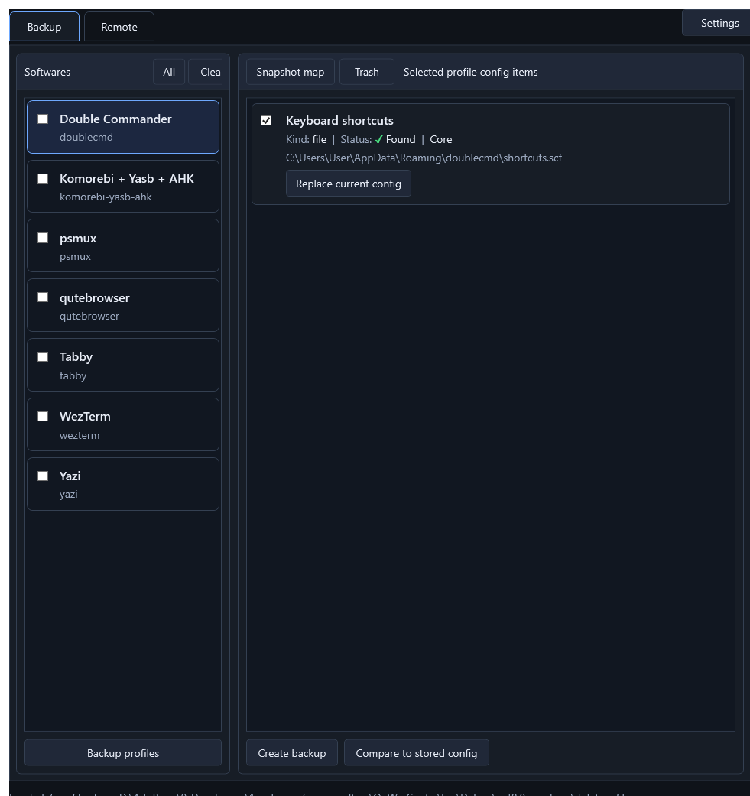
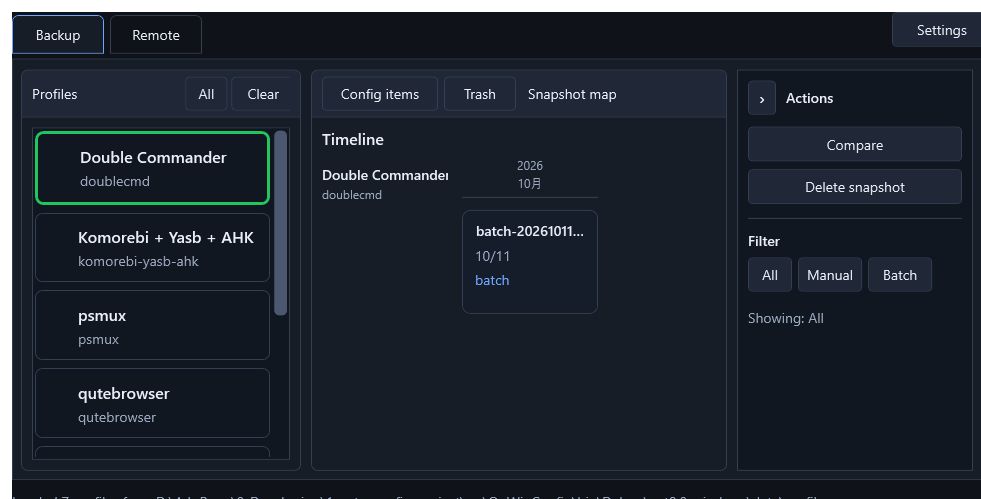

# oo-win-config

`oo-win-config` 是一個 Windows 設定檔備份工具。

它的目標很直接：把常用軟體的設定檔用明確的 profile 定義起來，讓備份、查看版本、還原、丟到垃圾桶這些動作都能在同一個介面完成。

目前是 WPF / .NET 8 桌面程式。資料不是放進資料庫，也不是用 Git 管理；snapshot 以資料夾和 `manifest.json` 存在檔案系統裡。

## 目前能做什麼

- 從 `data/profiles/*.json` 載入軟體設定檔定義。
- 針對單一 config item 建立備份。
- 勾選多個 profile 後批次備份，批次備份會標成 `batch`。
- 查看 snapshot map。
- 用 map 選擇 snapshot，並依 `manual` / `batch` 篩選。
- 刪除 snapshot 時不直接刪檔，而是移到 `data/trash/`。
- 從每個 config item card 直接還原最新備份。
- 還原前會詢問是否先把目前設定再備份一次。
- 如果完全沒有可用備份，會提示先建立一份 `manual` backup。
- 右鍵 snapshot card 可以用 Explorer 開啟對應資料夾。
- 在獨立的 `SSH Config` tab 管理 SSH config source 和 `Host` blocks。
- SSH config 支援多個檔案來源、Host card 編輯、新增/複製/延後刪除，以及寫回前建立備份。

## 介面

Backup 頁是主要工作區。左側是軟體 profile，右側是選中 profile 的 config items。



Snapshot map 用時間線看同一個 profile 的備份版本。右側 sidebar 放 actions 和 filter。



`SSH Config` tab 獨立管理 SSH 設定檔；remote profile backup 和遠端檔案操作不在這個 tab。

## 資料結構

Profile 定義放在：

```text
data/profiles/
```

每個 snapshot 會開自己的資料夾：

```text
data/backups/{profileId}/{snapshotId}/
  manifest.json
  ...copied config files
```

Trash 目前分成 general / remote scope：

```text
data/trash/general/{profileId}/{snapshotId}/
data/trash/remote/{profileId}/{snapshotId}/
```

`manifest.json` 是 snapshot map 和還原功能讀取的主要資料來源。

## Profile

目前 repo 內已有幾個 profile：

- Double Commander
- Komorebi + Yasb + AHK
- psmux
- qutebrowser
- Tabby
- WezTerm
- Yazi

每個 profile 會定義 config item 的來源路徑和備份內的相對路徑，例如：

```json
{
  "id": "doublecmd",
  "name": "Double Commander",
  "configItems": [
    {
      "id": "shortcuts",
      "name": "Keyboard shortcuts",
      "kind": "file",
      "defaultSourcePath": "{AppData}/doublecmd/shortcuts.scf",
      "backupPath": "doublecmd/shortcuts.scf",
      "required": true
    }
  ]
}
```

支援的路徑 token 目前包含：

- `{AppData}`
- `{LocalAppData}`
- `{UserProfile}`
- `{ProgramFiles}`
- `{Startup}`
- `{CommonStartup}`

## Build

開發 build：

```powershell
dotnet build oo-win-config.sln
```

輸出位置：

```text
src/OoWinConfig/bin/Debug/net8.0-windows/
```

Portable publish：

```powershell
dotnet publish src/OoWinConfig/OoWinConfig.csproj -c Release -o dist/oo-win-config
```

正式輸出會放在：

```text
dist/oo-win-config/
```

## Release Package

產生 GitHub Release 用的 zip：

```powershell
scripts/package-release.ps1
```

預設會輸出：

```text
dist/oo-win-config.zip
```

這個 zip 會包含程式檔與內建 `data/profiles/`，但不包含使用者資料：

```text
data/backups/
data/trash/
data/settings/
data/debug/
```

## Update From Latest Release

已安裝過的資料夾可以用 latest release 固定連結更新：

```powershell
scripts/update-latest.ps1 -InstallDirectory "D:\path\to\oo-win-config"
```

預設下載：

```text
https://github.com/curtyuan/oo-win-config/releases/latest/download/oo-win-config.zip
```

更新時會覆蓋程式檔與 `data/profiles/`，但保留：

```text
data/backups/
data/trash/
data/settings/
data/debug/
```

`scripts/` 是專案的一部分，會進 Git；產出的 `dist/oo-win-config.zip` 和 publish 目錄不進 Git。

## Visual Smoke Capture

程式內有一個開發用的截圖 hook，用來快速檢查 UI 是否能正常載入。

```powershell
src/OoWinConfig/bin/Debug/net8.0-windows/OoWinConfig.exe --capture-ui --exit-after-capture
```

指定 Snapshot map：

```powershell
src/OoWinConfig/bin/Debug/net8.0-windows/OoWinConfig.exe --capture-ui --view snapshot-map --exit-after-capture
```

截圖會輸出到：

```text
src/OoWinConfig/bin/Debug/net8.0-windows/data/debug/screenshots/
```

這個資料夾不進 Git。

## 還沒完成的部分

- Remote profile management 尚未實作；Remote 頁目前提供規劃中的流程和 SSH Config 導向。
- SSH Config 尚未支援自動展開 `Include` 檔案，included files 需另外加入為 config source。
- Snapshot map 已讀實際 backup manifest，但比較內容仍是 placeholder overlay。
- Theme 設定目前有入口，還沒整理成完整可切換的 theme resource 系統。
- Trash 目前有 general / remote scope，但 remote scope 尚未接真遠端資料來源。
